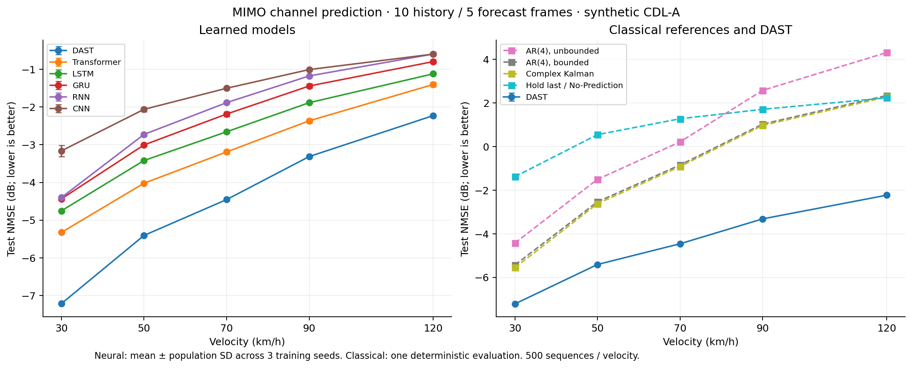
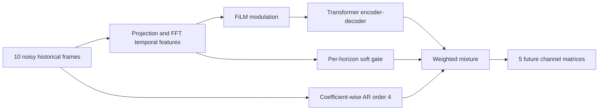
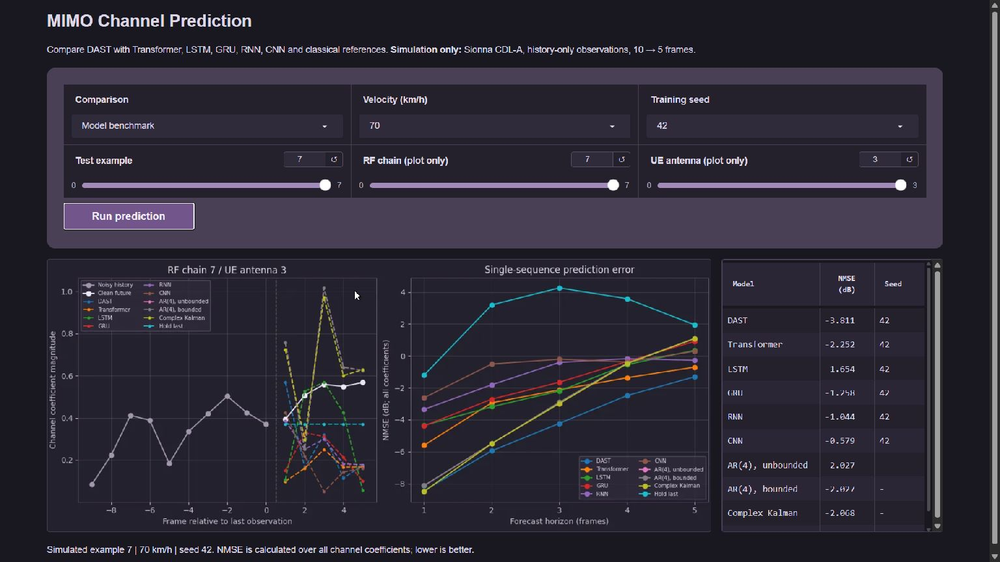

# DAST — MIMO Channel Prediction

Predict five future wireless-channel matrices from ten noisy historical
observations. This graduation project combines a Transformer with a classical
autoregressive predictor and an FFT-feature-dependent blending gate.

**Python · PyTorch · Sionna · Transformer · Time-series prediction · Gradio**



## What it does

Wireless channels change as a receiver moves. A transmitter using an outdated
channel estimate can choose a beam that no longer matches the channel.
This project studies short-horizon prediction of the effective MIMO channel
in a controlled simulation.

- **Input:** 10 frames, each with 8 RF chains × 4 receive antennas × real/imaginary components.
- **Output:** 5 future channel matrices, predicted in parallel.
- **Simulation:** one UE, 64 physical BS antennas, 8 RF chains, 30 GHz CDL-A,
  0.125 ms frame spacing, one subcarrier.
- **Demo:** compare six neural models, classical references and component ablations on fixed held-out examples, with
  coefficient trajectories and per-horizon NMSE.

This is synthetic channel prediction, not an SDR deployment or a measured-radio benchmark.

## Architecture



The classical branch is an AR/least-squares predictor. The thesis and internal
configuration call it a PAD prior; it is not a full angle-delay-domain PAD
implementation. The gate blends two predictions rather than choosing one with
a hard switch. No ground-truth velocity is provided to the model.

## Results

The benchmark includes **6 neural models × 3 seeds = 18 trained models**, plus
**3 DAST ablations × 3 seeds = 9 models**, for **27 training runs** on
8,000 training and 1,000 validation sequences. Each model is tested on 500
sequences at each of five velocities: **2,500 test sequences** in total.
All checkpoints are selected by validation NMSE.

| Test velocity | DAST NMSE | Transformer NMSE | Improvement |
|---|---:|---:|---:|
| 30 km/h | −7.214 dB | −5.325 dB | 1.888 dB |
| 50 km/h | −5.406 dB | −4.021 dB | 1.385 dB |
| 70 km/h | −4.455 dB | −3.191 dB | 1.264 dB |
| 90 km/h | −3.313 dB | −2.365 dB | 0.948 dB |
| 120 km/h | −2.228 dB | −1.403 dB | 0.825 dB |

Scores are means of three seed-level dB scores; lower is better. Improvements
are computed from unrounded scores. The complete
[model comparison and seed variability](docs/benchmark-results/README.md) includes
DAST, Transformer, LSTM, GRU, RNN, CNN, AR(4), Complex Kalman and Hold last.
The [initial study and component ablations](docs/results/README.md) are reported separately.

DAST has the lowest mean NMSE among the evaluated methods in these five scenarios.
This finding is limited to the stated synthetic dataset and training recipe.

The AR prior accounts for most of the improvement under this recipe. Removing
FiLM produces nearly equivalent scores, and a fixed gate is slightly better at
90–120 km/h. These results do not show that every proposed component helps in
every condition. No statistical-significance or real-world throughput claim is made.

## Run the demo

Tested on Windows with Python 3.10 and CPU PyTorch 2.6.0. Install
[uv](https://docs.astral.sh/uv/getting-started/installation/), then run from this directory:

```sh
uv sync --locked --extra train
```

Download the [v1.0.0 inference bundle](https://github.com/MinhNhan0508/channel-prediction/releases/download/v1.0.0/dast-benchmark-v1-inference.zip)
and extract it **at the repository root**. It creates `artifacts/benchmark-v1/`.
Then run:

```sh
uv run --locked python tools/smoke_inference.py
uv run --locked python app.py
```

Open **http://127.0.0.1:7860/**. The demo runs on CPU and does not retrain models.
The bundle contains 27 inference-only weights, a manifest with integrity digests,
and 40 fixed examples. Training datasets and resumable checkpoints are kept
outside source history. See [demo instructions](docs/demo.md).



## Thesis and presentation

- [Thesis report (Vietnamese, 82 pages)](https://github.com/MinhNhan0508/channel-prediction/releases/download/v1.0.2/dast-thesis-report.vi.pdf)
- [Defense slides (Vietnamese, 24 slides)](https://github.com/MinhNhan0508/channel-prediction/releases/download/v1.0.2/dast-thesis-slides.vi.pdf)

These are public copies of the July 2026 academic documents. Student IDs and
administrative review/signature pages have been removed; the technical content
is preserved. Their results describe the thesis-era experiments, while the
benchmark above was rerun after the thesis. See the [document notes](docs/thesis/README.md)
for the differences and file checksums.

## Reproduce and test

```sh
uv run --locked --extra train python -m unittest discover -s tests -v
uv run --locked python tools/check_report.py
uv run --locked python -m tools.check_benchmark
```

Tests cover model contracts, history-only preprocessing, dataset provenance,
weighted validation metrics, deterministic CPU interruption/resume, single-writer
training control, bundle integrity and inference. A small synthetic end-to-end
training test verifies the suite; it is not the reported benchmark.

[Reproduction instructions](docs/reproduction.md) describe the separate Sionna
generation environment, dataset checks, full training matrix, resume and evaluation.
The formal GPU run used a GTX 1650 and PyTorch 2.6.0+cu124. The CPU demo environment
is separate; it does not imply that the formal experiment was trained on CPU.

## Repository guide

| Path | Contents |
|---|---|
| `src/models/` | DAST, classical prior and baseline implementations |
| `src/data/` | Historical-observation policy, normalization and provenance |
| `src/training/` | Training, checkpoint and resume logic |
| `src/inference.py` | Verified inference-bundle loader |
| `configs/` | Maintained model and experiment recipes |
| `scripts/01b_generate_sionna.py` | Synthetic channel generation |
| `tools/` | Training suite, evaluation, dataset checks and result reporting |
| `tests/` | Automated code and pipeline checks |
| `docs/` | Methodology, experiments, results and demo instructions |
| `app.py` | Local Gradio comparison app |

The [benchmark protocol](docs/benchmark.md) explains the additional baseline
suite, classical reference settings and the distinction between model-family
comparisons and component ablations.

## Assumptions and limitations

- Beam selection uses ideal clean historical physical-channel pilots. Beam
  selection and noise-power calibration never use future frames.
- The combiner is fixed across the history/forecast window. Noise is added to
  history; clean future effective channels are prediction targets.
- A training-only normalization scale is reused for validation, test and demo.
- One subcarrier and one channel family do not establish wideband robustness
  or generalization to measured channels.
- NMSE is the measured outcome. This release does not claim BER, spectral
  efficiency, real-time execution or deployment latency improvements.
- Exact bitwise reproduction across different hardware/library versions is
  not promised. The original execution environment and fingerprints are recorded.

Read the [methodology and references](docs/methodology.md) and
[experiment protocol](docs/experiments.md) for details.

## Contribution

**Lê Minh Nhân — sole technical developer in a two-person graduation-thesis team.**
Implemented channel generation, the hybrid model, training and evaluation,
controlled ablations and the interactive demo. The teammate contributed to the
written report, slides and supporting theory.

The model was developed from the cited literature and standard Transformer
components. This repository does not claim to reproduce every attention
mechanism or published score from those papers.

## License

[MIT](LICENSE). Dependency licenses remain with their respective authors;
see [third-party notices](NOTICE.md).
