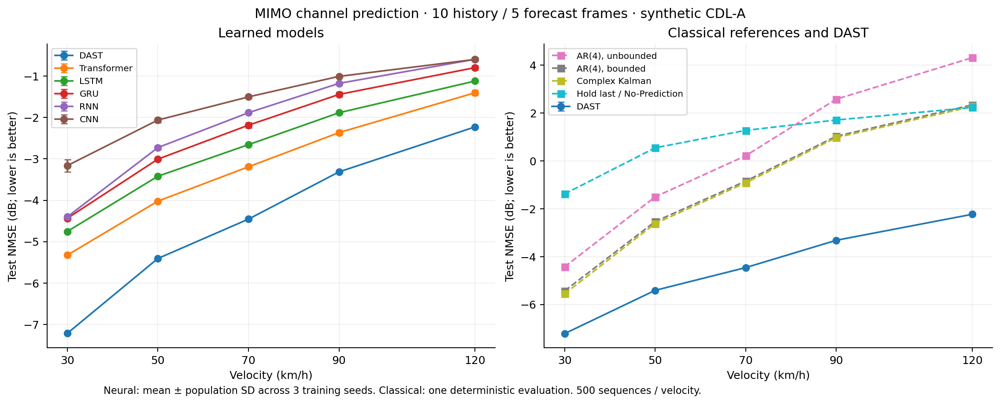

# Model benchmark

All methods use the same held-out history-only CDL-A observations and targets.
Neural models share the same recipe and validation-based checkpoint selection.
The four additional neural baselines extend the initial DAST/Transformer study.

| Method | 30 km/h | 50 km/h | 70 km/h | 90 km/h | 120 km/h |
|---|---:|---:|---:|---:|---:|
| DAST | -7.214 ± 0.018 | -5.406 ± 0.019 | -4.455 ± 0.024 | -3.313 ± 0.016 | -2.228 ± 0.009 |
| Transformer | -5.325 ± 0.025 | -4.021 ± 0.020 | -3.191 ± 0.050 | -2.365 ± 0.056 | -1.403 ± 0.064 |
| LSTM | -4.753 ± 0.038 | -3.419 ± 0.012 | -2.656 ± 0.016 | -1.884 ± 0.012 | -1.120 ± 0.004 |
| GRU | -4.434 ± 0.026 | -3.006 ± 0.028 | -2.186 ± 0.064 | -1.442 ± 0.060 | -0.796 ± 0.051 |
| RNN | -4.400 ± 0.035 | -2.727 ± 0.053 | -1.884 ± 0.022 | -1.175 ± 0.024 | -0.595 ± 0.010 |
| CNN | -3.162 ± 0.148 | -2.061 ± 0.058 | -1.502 ± 0.039 | -1.006 ± 0.028 | -0.597 ± 0.041 |
| AR(4), unbounded | -4.423 | -1.500 | 0.218 | 2.581 | 4.312 |
| AR(4), bounded | -5.430 | -2.532 | -0.842 | 1.033 | 2.342 |
| Complex Kalman | -5.552 | -2.615 | -0.912 | 0.974 | 2.276 |
| Hold last / No-Prediction | -1.379 | 0.549 | 1.278 | 1.712 | 2.235 |

- Standard deviations describe three training seeds, not confidence intervals.
- Deterministic references are evaluated once; no artificial seed variability is added.
- AR(4) is coefficient-wise least-squares prediction, not a full angular-delay PAD reproduction.
- Bounded AR exposes the effect of the amplitude cap used by the DAST prior.
- Kalman uses a complex Hermitian covariance and Joseph update. Its Q/R heuristic is fitted from history.
  It differs from the original real-covariance approximation; old thesis scores are not reused.
- No-Prediction repeats the last noisy observation; zero dB does not define this baseline.
- Component ablations belong in a separate figure; they are not independent model families.
