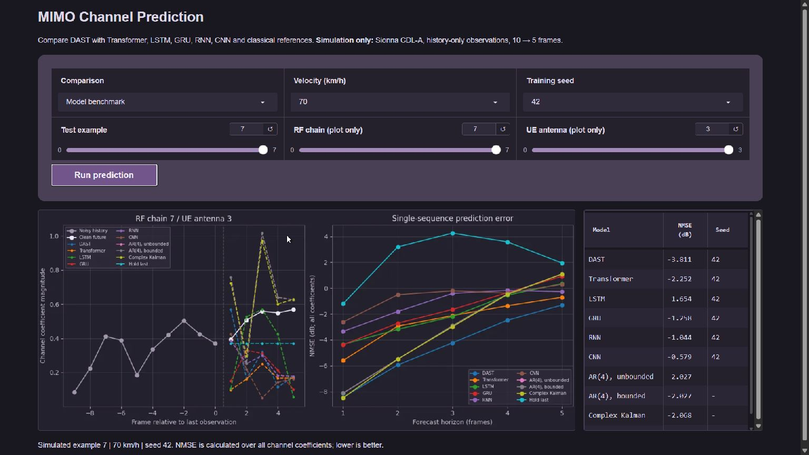

# Local demo

The demo runs pretrained models on CPU. It requires no radio hardware, cloud
account, API key or training job. After installation, model inference works offline.

## Start

From the repository root, install the locked environment and extract the
[inference ZIP](https://github.com/MinhNhan0508/channel-prediction/releases/download/v1.0.0/dast-benchmark-v1-inference.zip)
at the repository root. The resulting `artifacts/benchmark-v1/` directory must contain `manifest.json`,
`examples.npz` and the 27 inference-only `.pt` files.

```sh
uv sync --locked --extra train
uv run --locked python tools/smoke_inference.py
uv run --locked python app.py
```

Open `http://127.0.0.1:7860/`. Keep the terminal open while using the app.
To select another port, use `python app.py --port 7861`. Stop it with Ctrl+C.
The server binds to loopback and does not create a public Gradio share link.

## Interface

The local demo uses a muted purple theme. Prediction settings are grouped above
**Run prediction**. The chart is on the left and the compact score table is on
the right; the results stack vertically on narrower screens. Scroll within the table to
see any rows below the visible area.



## Explore

1. Choose a test velocity, example index and training seed.
2. Choose **Model benchmark** or **Component ablations**, then click **Run prediction**.
   Every method receives the same noisy history. Classical references are deterministic;
   the selected training seed applies only to neural models. A dash in the Seed
   column marks a deterministic reference.
3. The left plot shows one complex channel coefficient's magnitude over time.
   Change RF chain or UE antenna to inspect another coefficient.
4. The right plot and score table measure error across all coefficients,
   regardless of which coefficient is drawn on the left.

Indices 0–7 are the first eight lexicographically sorted test sequences at each
velocity. They were not selected by model score. A single-example score can be
very different from the full test-set average in `docs/benchmark-results/README.md`.
Velocity is simulation metadata for selecting examples, not a model input.
The forecast sampling interval is 0.125 ms. The magnitude plot shows one
coefficient; NMSE uses all 8 × 4 complex coefficients. Beam selection assumes
ideal clean historical pilots. These assumptions also apply to the demo.


The app verifies file digests, model source identity and tensor shapes. It refuses
legacy-policy bundles and incompatible weights. It never silently substitutes
an old checkpoint or a random model when an artifact is missing.

## Troubleshooting

- **Connection refused:** start `app.py` and wait for the local URL in the terminal.
- **Port already in use:** stop your previous demo process or choose another port.
- **Missing bundle:** extract the matching inference artifact; do not rename an
  old thesis checkpoint to satisfy the expected filename.
- **Integrity/source mismatch:** restore the matching source and bundle. Digests
  detect mismatched/corrupted files; they do not authenticate an untrusted download.
- **Slow first prediction:** CPU model loading occurs on the first request and
  loaded models are cached for later requests. No speed claim is made from this.
