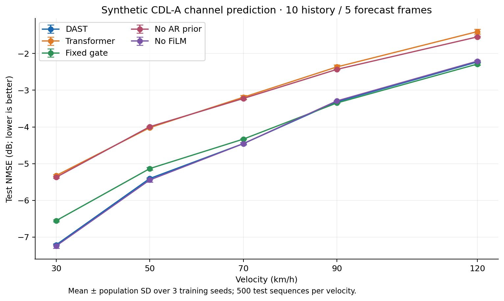
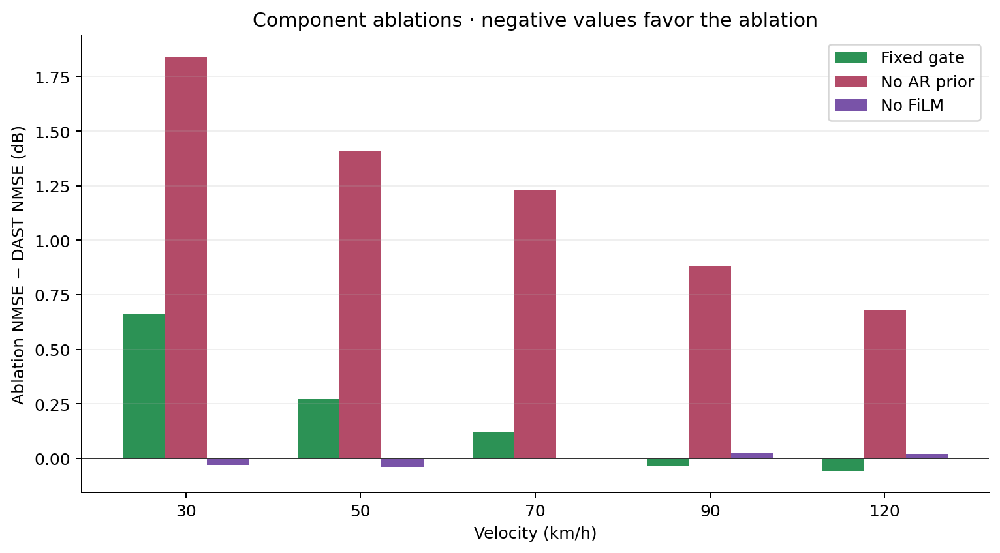

# Formal evaluation results

Synthetic CDL-A, history-only observations. Lower NMSE is better.

Each cell is mean ± population standard deviation in dB over seeds 42, 123 and 2024.
Each seed is evaluated on the same 500 test sequences at each velocity.

| Variant | 30 km/h | 50 km/h | 70 km/h | 90 km/h | 120 km/h |
|---|---:|---:|---:|---:|---:|
| DAST | -7.214 ± 0.018 | -5.406 ± 0.019 | -4.455 ± 0.024 | -3.313 ± 0.016 | -2.228 ± 0.009 |
| Transformer | -5.325 ± 0.025 | -4.021 ± 0.020 | -3.191 ± 0.050 | -2.365 ± 0.056 | -1.403 ± 0.064 |
| Fixed gate | -6.555 ± 0.029 | -5.135 ± 0.034 | -4.332 ± 0.015 | -3.346 ± 0.010 | -2.287 ± 0.031 |
| No AR prior | -5.372 ± 0.023 | -3.994 ± 0.015 | -3.224 ± 0.029 | -2.432 ± 0.011 | -1.547 ± 0.019 |
| No FiLM | -7.243 ± 0.063 | -5.445 ± 0.062 | -4.456 ± 0.034 | -3.290 ± 0.009 | -2.207 ± 0.023 |

## Interpretation

- DAST improves on the vanilla Transformer in all five tested velocity scenarios.
- Removing the AR prior loses most of that improvement under this recipe.
- Removing FiLM gives nearly the same scores. These results do not establish a consistent FiLM benefit.
- The fixed gate is slightly better at 90 and 120 km/h. Input-dependent gating does not win everywhere.
- Small ablation differences and three training seeds do not establish statistical significance.
- These scores do not measure real-channel generalization, BER, radio throughput or deployment latency.

## Files and metric

`scores.csv` contains all 75 individual scores; `summary.csv` contains 25 aggregate rows.
For each seed, average the per-sample, per-horizon **linear** NMSE ratios before converting to dB.
Then compute mean/std across the three seed scores. Error bars describe seed variability,
not confidence intervals. Checkpoints are selected by validation NMSE, never by test score.
